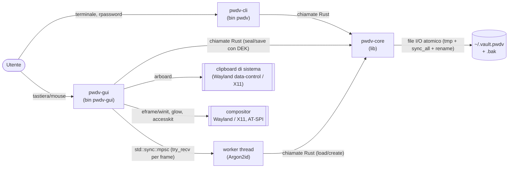

# Architettura — pwdv
_Ultimo aggiornamento: 2026-11-23_

Chiavi, algoritmi e procedure di sostituzione: [CRYPTO-INVENTORY.md](CRYPTO-INVENTORY.md).

## Vista d'insieme

pwdv è un password manager **locale e offline**: due eseguibili (CLI `pwdv` e GUI
`pwdv-gui`) che leggono e scrivono lo stesso file cifrato `.pwdv` tramite una libreria
comune, `pwdv-core`. Non c'è server, rete, database né processo in background: lo stato
persistente è un solo file (più il suo `.bak`). La dipendenza va in un solo verso:
cli → core, gui → core; il core non conosce interfacce.

## Stack tecnologico

| Tecnologia | Versione | Ruolo | Perché | Dove |
|---|---|---|---|---|
| Rust | edition 2021, toolchain ≥ 1.95 | Linguaggio | Sicurezza di memoria, ecosistema RustCrypto — [ADR 0001](decisions/0001-scelta-stack.md) | tutto il workspace |
| `argon2` | 0.5 (feat. `zeroize`) | KDF Argon2id v0x13 | Raccomandato da RFC 9106, memory-hard | `pwdv-core/src/crypto.rs` |
| `chacha20poly1305` | 0.10 | AEAD XChaCha20-Poly1305 | Nonce 24B casuali sicuri — [ADR 0002](decisions/0002-formato-file-e-due-livelli-di-chiave.md) | `pwdv-core/src/crypto.rs` |
| `rand` | 0.8 | `OsRng` per DEK, salt, nonce, generatore password | CSPRNG del SO | core, cli |
| `zeroize` | 1 (feat. `zeroize_derive`) | Azzeramento di chiavi e plaintext | Riduce la permanenza di segreti in memoria | core, cli, gui |
| `serde` + `serde_json` | 1 | Serializzazione del contenuto del vault (JSON) | Schema semplice e versionato | `pwdv-core/src/vault.rs` |
| `thiserror` | 1 | Tipo `VaultError` | Errori tipizzati senza segreti | `pwdv-core/src/error.rs` |
| `unicode-normalization` | 0.1.26 | NFKC della master password prima di Argon2id | NIST SP 800-63B — [ADR 0005](decisions/0005-normalizzazione-nfkc-master-password.md) | `pwdv-core/src/policy.rs`, usata in `crypto.rs` |
| `clap` | 4 (feat. `derive`) | Parsing comandi CLI | Standard de facto | `pwdv-cli` |
| `libc` | 0.2 (solo `cfg(unix)`) | `setrlimit` e `prctl` per disattivare i core dump, `mlock` per bloccare in RAM chiavi e password | La libreria standard non le espone — ADR [0008](decisions/0008-disattivazione-core-dump.md), [0009](decisions/0009-blocco-in-ram-dei-segreti.md) | `pwdv-core/src/hardening.rs` |
| `rpassword` | 7 | Lettura password da terminale senza eco | Password mai come argomenti | `pwdv-cli` |
| `eframe` / `egui` | 0.36 (`glow`, `wayland`, `x11`, `accesskit`, `default_fonts`; **niente `persistence`**) | GUI immediate-mode | [ADR 0003](decisions/0003-gui-eframe-egui.md) | `pwdv-gui` |
| `arboard` | 3.6 (feat. `wayland-data-control`) | Clipboard di sistema | Su Hyprland il clipboard XWayland non raggiunge le app Wayland | `pwdv-gui/src/security.rs` |

## Componenti

### pwdv-core (libreria)
- **Responsabilità**: formato file v1, crittografia (KEK/DEK), modello dati, lettura e scrittura atomica del vault.
- **Dipende da**: argon2, chacha20poly1305, rand, zeroize, serde/serde_json, thiserror, libc (solo unix). Nessun crate grafico.
- **Espone** (moduli pubblici):
  - `format` — `MAGIC`, `VERSION`, `HEADER_LEN = 130`, `KdfParams`, `Header::parse` / `to_bytes`
  - `crypto` — `derive_kek`, `seal`, `seal_with_key`, `reseal`, `open`, `open_with_key`, `change_master`, `VaultKey` (DEK + header[0..106], con `matches()` per rilevare riscritture)
  - `hardening` — `disable_core_dumps()`: chiamata per prima nel `main` di CLI e GUI (`RLIMIT_CORE = 0`, su Linux anche `PR_SET_DUMPABLE = 0`; nessuna operazione su Windows) — [ADR 0008](decisions/0008-disattivazione-core-dump.md). `lock_bytes` / `lock_string` (`mlock`, mai `munlock`) e `memory_lock_failed()` per avvisare l'utente — [ADR 0009](decisions/0009-blocco-in-ram-dei-segreti.md)
  - `key` — `Key32` (byte in `Box` bloccato in RAM, azzerato al drop, accesso via `as_bytes()`)
  - `policy` — `MIN_MASTER_CHARS = 15`, `MAX_MASTER_CHARS = 256`, `too_long()`, `check_new_master()` → `Weakness` (lunghezza minima e massima, elenco comune incorporato da `data/common-passwords.txt`, ripetizioni, sequenze, parola "pwdv"); `nfkc()` usata da `crypto`. Applicata da CLI (`init`, `passwd`) e GUI (creazione), mai allo sblocco — ADR [0004](decisions/0004-lunghezza-minima-master-password.md), [0005](decisions/0005-normalizzazione-nfkc-master-password.md), [0006](decisions/0006-elenco-password-comuni.md)
  - `vault` — `Entry`, `VaultData`, `DATA_VERSION = 1`
  - `store` — `load`, `load_with_key`, `save`, `save_with_key`, `create`, `change_password`, `rekey`
  - `error` — `VaultError` (`BadMagic`, `UnsupportedVersion`, `Truncated`, `AuthFailed`, `Malformed`, `Conflict`, `Kdf`, `Io`)
- **Dati posseduti**: il file `.pwdv` e `<vault>.bak`.

### pwdv-cli (binario `pwdv`)
- **Responsabilità**: interfaccia da terminale; messaggi in inglese.
- **Dipende da**: pwdv-core, clap, rand, rpassword, zeroize.
- **Espone**: comandi `init`, `add`, `get`, `list`, `rm`, `passwd`, `rekey`, `gen`; opzione `--vault <PATH>` (default `$HOME/.vault.pwdv`).
- **Dati posseduti**: nessuno oltre al vault. Ogni comando deriva la KEK dalla master password (nessuna sessione).

### pwdv-gui (binario `pwdv-gui`)
- **Responsabilità**: uso quotidiano; messaggi in italiano.
- **Dipende da**: pwdv-core, eframe, arboard, zeroize.
- **Moduli**:
  - `app` — macchina a stati `AppState`: `Welcome` → `Creating` | `Unlocking` → `Unlocked(Box<Session>)`; `Error(String)`. `Unlocking` è anche lo stato "bloccato".
  - `unlock` — schermate di sblocco/creazione, buffer password a capacità fissa, backoff dopo 3 errori.
  - `worker` — Argon2id su thread dedicato, risultato su `mpsc` letto con `try_recv()` a ogni frame.
  - `main_view` — elenco con ricerca fuzzy, dettaglio, modifica, eliminazione con conferma per nome.
  - `security` — `IdleTimer` (doppio orologio `Instant` + system time, per la sospensione) e `Clipboard` che si svuota dopo 20 s.
  - `window` — cornice disegnata dall'app (finestra senza decorazioni di sistema).
  - `theme` — palette, forme e componenti condivisi (in lavorazione, non ancora committato).
- **Dati posseduti**: `Session` in memoria (path, `VaultKey`, `VaultData`, stato vista). Nulla su disco oltre al vault.

## Comunicazione tra componenti

| Da | A | Meccanismo | Formato dati | Sincrono? | Note (auth, errori, retry) |
|---|---|---|---|---|---|
| cli | core | chiamata di funzione | tipi Rust (`VaultData`, `&[u8]` password) | sì | `VaultError` → messaggio su stderr |
| gui (thread UI) | worker | `std::thread` + `mpsc::channel` | password spostata nel thread, risultato `VaultKey` + `VaultData` | no (polling per frame) | password azzerata nel worker subito dopo la derivazione; spinner nella UI |
| worker | core | chiamata di funzione | `store::load_with_key` / `store::create` | sì (nel worker) | errore auth unico: "Password errata o file danneggiato" |
| gui | core | chiamata di funzione | `store::save_with_key` con `VaultKey` | sì, sul thread UI (niente Argon2) | `Conflict` se il file è stato riscritto con un'altra chiave; errore persistente con **Riprova** |
| core | filesystem | `std::fs` | file binario `.pwdv` v1 | sì | prima il file attuale → `<vault>.bak`, poi il nuovo: entrambi tmp nella stessa dir → `sync_all` → `rename` → sync della dir (unix). La creazione usa `hard_link` al posto di `rename` (non sostituisce mai un file esistente). Permessi `0600` (unix) |
| gui | clipboard | `arboard` | testo + MIME `x-kde-passwordManagerHint` (Linux) | sì | svuotato dopo 20 s solo se contiene ancora il valore; svuotato a blocco e chiusura |
| gui | compositor | eframe/winit | eventi input, rendering OpenGL | sì | AT-SPI via accesskit per i lettori di schermo |

## Flussi principali

**Sblocco (GUI)**
1. L'utente sceglie il path (`Welcome`), il file esiste → `Unlocking`.
2. Invio: la password viene spostata in un thread `worker`, il buffer UI viene `zeroize()` + `clear()`.
3. Il worker esegue `store::load_with_key`: Argon2id → KEK → unwrap DEK (AAD `header[0..34]`) → open vault (AAD `header[0..6] ++ header[106..130]`) → JSON → `VaultData`.
4. La UI riceve il risultato via `try_recv()` → `Unlocked(Session)` con la DEK in `VaultKey`.

**Salvataggio (GUI)**
1. Modifica di una voce → `store::save_with_key(path, key, data)`.
2. Il core rilegge il file: se `key.matches(file)` è falso → `Conflict`, nessuna scrittura.
3. Altrimenti `reseal` con nuovo `vault_nonce` da `OsRng`, scrittura atomica, il precedente diventa `.bak`.

**Cambio master password (CLI `pwdv passwd`)**
1. `store::change_password`: unwrap della DEK con la vecchia password.
2. Nuovo salt, nuova KEK, re-wrap della DEK; il ciphertext del vault resta identico.
3. Il `.bak` viene eliminato (si aprirebbe con la vecchia password).

**Sostituzione della DEK (CLI `pwdv rekey`)**
1. `store::rekey`: `crypto::open` con la password attuale (Argon2id + unwrap + verifica del tag).
2. `crypto::seal` sullo stesso plaintext: nuova DEK, salt e nonce da `OsRng`, parametri KDF predefiniti.
3. Scrittura atomica; il file precedente diventa `.bak`. Una GUI aperta con la vecchia chiave riceve `Conflict`.

Nota: anche `store::save` (CLI `add`, `rm`) passa da `crypto::seal`, quindi ogni salvataggio della CLI genera una DEK nuova; `save_with_key` (GUI) la mantiene.

**Blocco (GUI)**: Ctrl+L, menu o `IdleTimer` scaduto → salvataggio della bozza valida → svuotamento clipboard → drop della `Session` (DEK e voci azzerate) → `Unlocking`.

## Dati e persistenza

- **File `.pwdv` v1** (header 130 byte, poi ciphertext + tag):

  | offset | len | campo |
  |---|---|---|
  | 0 | 4 | magic `PWDV` |
  | 4 | 1 | version = 1 |
  | 5 | 1 | kdf_id = 1 (Argon2id) |
  | 6 | 4 | m_cost KiB, u32 LE |
  | 10 | 4 | t_cost, u32 LE |
  | 14 | 4 | p_cost, u32 LE |
  | 18 | 16 | salt |
  | 34 | 24 | dek_nonce |
  | 58 | 48 | wrapped_dek (32B DEK + 16B tag) |
  | 106 | 24 | vault_nonce |
  | 130 | .. | ciphertext + tag Poly1305 |

  AAD: wrap/unwrap DEK = `header[0..34]`; seal/open vault = `header[0..6] ++ header[106..130]`. Limiti in lettura: m_cost ≤ 1 GiB, t_cost ≤ 64, p_cost ≤ 64.
- **Plaintext**: JSON `{ "version": 1, "entries": [ { name, username, password, url, notes, created, modified } ] }`; timestamp in secondi Unix. Versione di schema sconosciuta → `Malformed`.
- **Backup**: `<vault>.bak` = versione precedente all'ultimo salvataggio.
- **Migrazioni**: nessuna. Un nuovo formato richiede un nuovo `version` nell'header.

## Integrazioni esterne

Nessuna rete. Interazioni solo locali: filesystem, clipboard di sistema, compositor
Wayland/X11, AT-SPI (accessibilità).

## Configurazione e deploy

- **Variabili d'ambiente**: `HOME` (default `~/.vault.pwdv` in CLI e GUI), `PWDV_AUTOLOCK_SECONDS` (GUI, 10–86400).
- **Build**: `cargo build --release` (in debug Argon2 è molto lento).
- **Installazione Linux**: `./install.sh` → `~/.local/bin`, voce `.desktop` da `packaging/linux/pwdv.desktop.in`, icona SVG; `PREFIX` configurabile. `./uninstall.sh` per rimuovere.
- **CI**: GitHub Actions (`.github/workflows/ci.yml`), solo Linux: `cargo fmt --check`, `cargo clippy --locked … -D warnings`, `cargo test --locked --workspace` a ogni push su `main` e a ogni PR; `cargo audit` (RustSec) anche ogni lunedì.

## Punti aperti / debito tecnico

- **Multipiattaforma (obiettivo) non ancora coperto**: default del vault basato su `HOME` (assente su Windows); permessi `0600`, sync della directory, disattivazione dei core dump e `mlock` solo `#[cfg(unix)]` (su Windows manca `VirtualLock`); MIME `x-kde-passwordManagerHint` solo Linux; `install.sh` e packaging solo Linux; nessun test su macOS/Windows.
- Generatore di password solo in CLI; tema chiaro/scuro assente (obiettivi correnti).
- `CLAUDE.md` parla di stato `Locked`, nel codice lo stato bloccato è `AppState::Unlocking`.
- Due GUI sullo stesso vault possono sovrascriversi (`Conflict` rileva solo cambi di chiave, non di contenuto).
- Copie non azzerabili in egui/winit/arboard (documentato nel README §9).
- La CI gira solo su Linux: nessun test automatico su macOS e Windows.
- Elenco di password comuni statico (SecLists xato-net, 10.898 voci ≥ 15 caratteri): non si aggiorna da solo e non copre le violazioni recenti (ADR 0006).
- Doppio percorso di sblocco per i vault creati prima di NFKC (ADR 0005): un vault resta "legacy" finché non si cambia la password.
